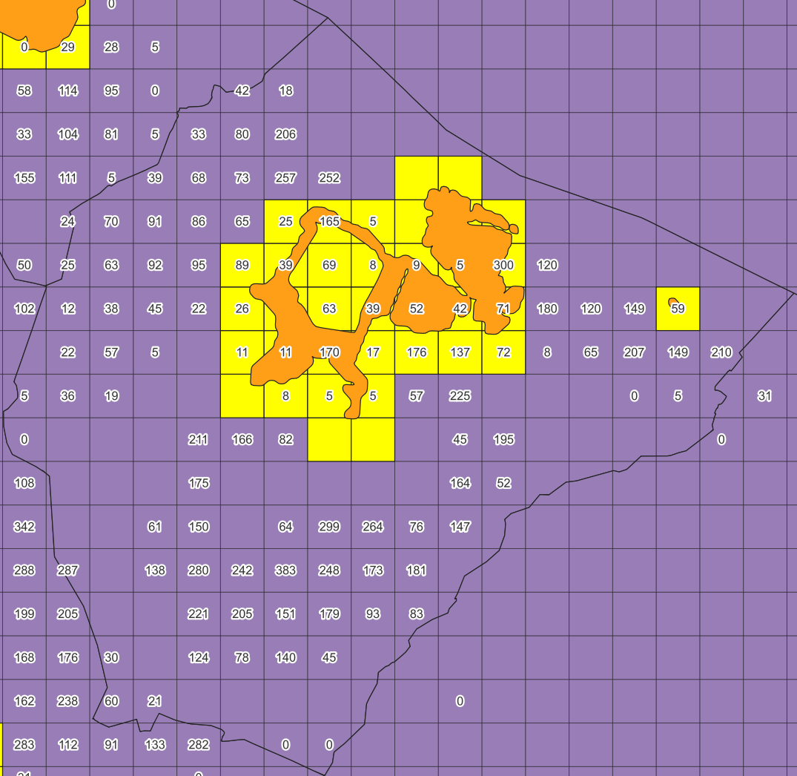
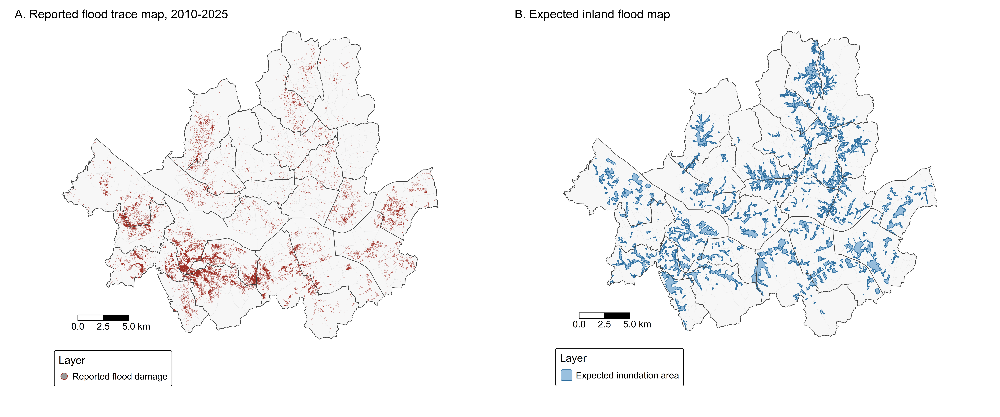
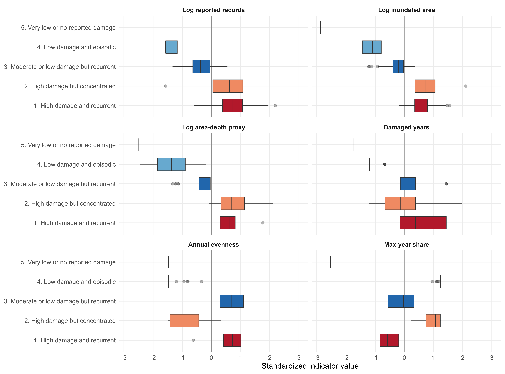
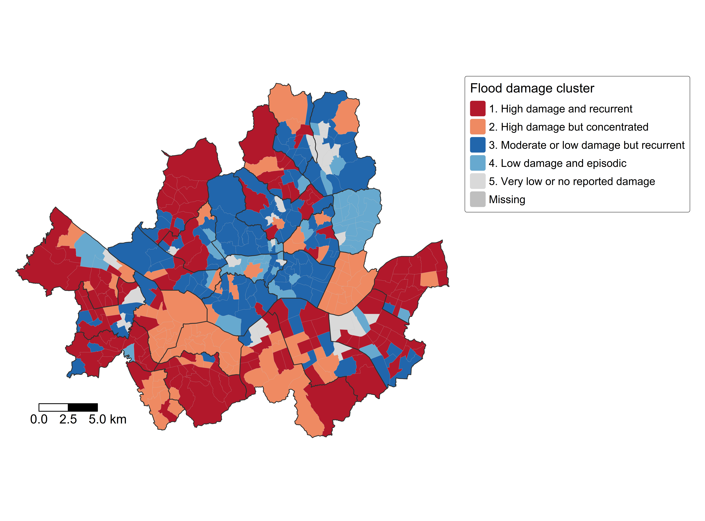
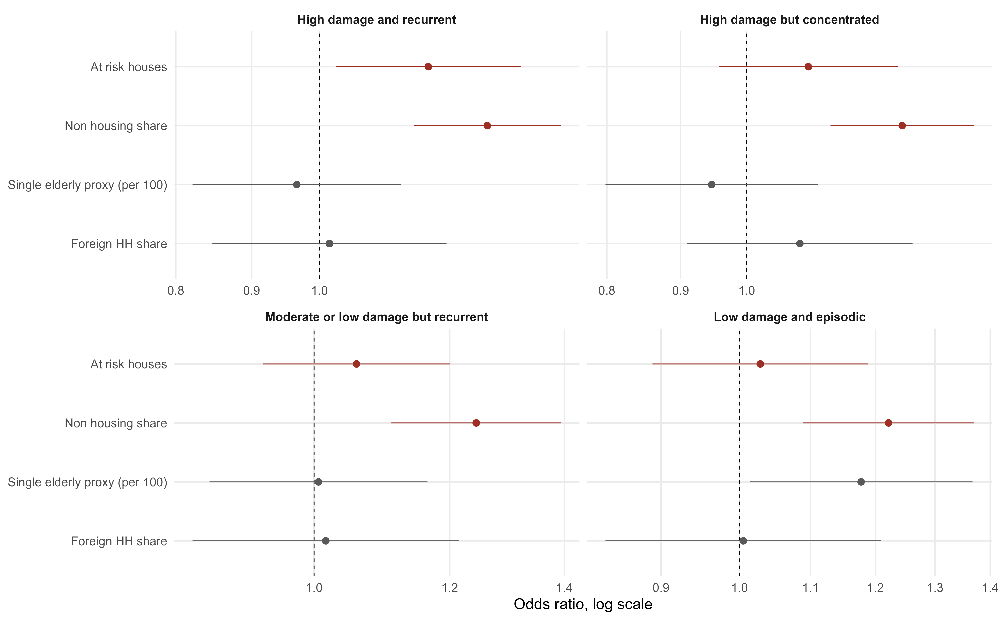

## Introduction

::: center
*“A lucidly woven class allegory of ascent and descent, at once biting and sorrowful.”*\
— Lee Dong-jin, translated by the author [@lee2019parasite]
:::

The film *Parasite*, directed by Bong Joon-ho, stages inequality in Seoul through a vertical geography of ascent and descent. This spatial representation becomes especially powerful in the film’s rainstorm sequence. The same precipitation that interrupts a wealthy family’s camping trip becomes a devastating flood for a family with lower income living in a downhill banjiha, or semi basement apartment. The scene shows that flood damage is not simply a matter of rainfall. It is mediated by class, housing, and the built environment. In this sense, Parasite offers more than a cinematic metaphor for inequality. It captures a central problem of urban climate vulnerability: environmental hazards do not fall on a socially flat landscape.

That cinematic image became tragically concrete during the August 2022 floods in Seoul. Record rainfall inundated roads, subway stations, and residential neighborhoods, and public attention focused especially on banjiha dwellings after residents were trapped and killed in a flooded unit [@reuters2022seoulflood]. The disaster made clear that flood vulnerability in Seoul is not distributed evenly across the urban landscape. It is shaped by where people live, what kinds of housing they can access, and how much capacity they have to move away from risk.

Vulnerability research provides a way to understand this unevenness. Climate hazards such as heavy rainfall, heat waves, and flooding become disasters through their interaction with exposure, sensitivity, and adaptive capacity [@adger2006vulnerability]. Disaster risk is not only a property of the hazard itself. It is produced through social relations, political and economic structures, and unsafe built environments [@wisner2004atrisk]. Environmental change may affect people directly, but its consequences are also shaped by economic, political, social, and demographic conditions [@black2011effect]. From this perspective, flood damage in Seoul should be understood not only as a hydrological or infrastructural outcome, but as a social process that shapes where damage occurs, how severe it becomes, and why it may recur.

Climate migration scholarship complicates the story further. Climate risk does not automatically produce migration, and mobility is not always available as an adaptive response. Migration depends on both aspirations and capabilities: people may want to move but lack the resources, rights, information, or social conditions that make movement possible [@dehaas2021theory; @schewel2020immobility]. This also means that immobility should not be treated as the passive absence of migration. It can reflect structural constraints, attachments to place, and unequal access to mobility [@adams2016persist; @schewel2020immobility]. In the context of urban flooding, the important question is therefore not only who is exposed to flood risk, but who has the capacity to leave.

Korea’s rental market adds a further layer to this problem. Unlike rental systems in many Western contexts, Korea’s rental market has historically been organized around large deposits paid upfront. The best known form is *jeonse*, a lease in which tenants pay a large refundable deposit instead of monthly rent. The influence of jeonse also extends to the monthly rent market, where many contracts still require substantial deposits. As a result, rental housing in Seoul is not only a matter of monthly affordability. It is also a matter of deposit access, deposit recovery, and financial liquidity.

Seoul’s flood vulnerability should therefore be understood in relation to Korea’s rental deposit system. A renter living in housing exposed to flooding may not be able to move simply because the unit is risky. Moving may require recovering an existing deposit, securing a new deposit, negotiating with landlords, paying brokerage fees, and absorbing moving costs. When a flood damages a dwelling, the tenant may lose not only housing quality and personal belongings but also financial security tied to the deposit. This paper therefore asks: How does housing precarity, embedded in a rental market organized around deposits, shape both the magnitude and recurrence of flood vulnerability while constraining residents’ ability to move out of Seoul’s most precarious housing environments? By analyzing flood damage patterns in Seoul alongside the structure of Korea’s rental market, this paper reframes urban flood vulnerability as a problem of housing precarity and constrained adaptation.

The paper proceeds as follows. Section 2 provides the institutional background of Korea’s rental housing market, focusing on the continuum between jeonse and monthly rent and the role of large deposits in rental contracts. Section 3 develops the theoretical framework by linking vulnerability, adaptive capacity, and immobility. Section 4 describes the data and methods and presents the spatial analysis of flood damage in Seoul. Section 5 presents the empirical results. Section 6 discusses how rental deposit arrangements may reproduce flood vulnerability by limiting residential mobility and complicating recovery.

## Seoul’s Rental Deposit System and the Cost of Moving

To understand flood vulnerability in Seoul, it is necessary to situate housing not merely as a physical structure but as a financial and institutional arrangement. In the Korean rental housing market, the boundary between ownership, lease, and monthly rent is unusually blurred because rental contracts are organized around large deposits. This large deposit structure is historically associated with the jeonse system, in which tenants provide landlords with a large deposit upfront instead of paying monthly rent. Although pure jeonse and pure monthly rent appear to stand at opposite ends of the rental spectrum, Korea’s actual rental market is better understood as a continuum of deposit and rent combinations.

The scale of jeonse is difficult to overstate. In a jeonse contract, the landlord rents a dwelling to the tenant in exchange for a large refundable deposit. The contract usually lasts two years, and the deposit is often around 70 percent of the house price [@jing2022credit]. In this arrangement, the tenant effectively lends a large sum of money to the landlord without interest in exchange for not paying monthly rent [@park_pyun2020]. This is why jeonse is often understood as a form of private housing finance, not simply as a rental contract. It is also not a marginal system. In 2010, about 33 percent of households in Seoul lived in jeonse housing [@kim2013chonsei].

The development of this system has been explained in several ways. Similar key money arrangements existed before the modern housing finance system, but the Korean form expanded under particular historical conditions. Studies commonly point to the underdevelopment of formal housing finance, limited access to mortgage credit, high inflation and interest rates, strong housing market regulations, and the demand for large sums of capital during Korea’s rapid urbanization [@kim2013chonsei; @park_pyun2020; @jing2022credit]. Put simply, jeonse connected two interests. Landlords needed capital that could be used for housing investment or other financial purposes, while tenants sought to reduce or avoid monthly rent payments.quar

The influence of jeonse extends beyond contracts based only on deposits. This institutional feature is visible in official statistical classifications. The Korea Real Estate Board subdivides the rental market outside jeonse according to the ratio of deposit to monthly rent. In this classification, *pure wolse* refers to monthly rent contracts with a small deposit, in which the deposit is up to 12 times the monthly rent; *quasi-wolse* refers to contracts in which the deposit is 12 to 240 times the monthly rent; and *quasi-jeonse* refers to contracts in which the deposit exceeds 240 times the monthly rent. The representative deposit to rent multiples used for these categories are 8, 48, and 480, respectively [@reb2026monthlyrent]. This classification itself is revealing. What is conventionally called “monthly rent” in Korea is rarely equivalent to a pure monthly payment system. Instead, even monthly rental contracts often require sizable deposits.

Recent transaction patterns in Seoul’s apartment rental market reinforce this point. According to the Ministry of Land, Infrastructure and Transport’s March 2026 housing statistics, contracts involving monthly rent accounted for 50.8 percent of Seoul apartment lease transactions in the first quarter of 2026 [@molit2026marchhousing; @tvchosun2026seoulrent]. In other words, Seoul’s apartment rental market was roughly divided between *jeonse* and contracts involving monthly rent. Yet the latter should not be mistaken for contracts based only on monthly payments. Based on Real Estate R114’s analysis of MOLIT transaction data, quasi-*wolse* accounted for more than half of Seoul apartment monthly rental contracts in 2025, while quasi-*jeonse* accounted for about 40 percent; pure *wolse* accounted for only a small minority [@r1142026junwolse; @newstomato2026junwolse]. Thus, even as Seoul’s rental market appears to be shifting from jeonse toward monthly rent, it remains deeply organized around deposits.

This matters because rental deposits in Korea are not simply contractual guarantees against damage or unpaid rent. They are financial instruments embedded in housing contracts. Lee and Chung describe Korea’s “monthly rent with variable deposit” as a distinctive contract form and argue that the chonsei or jeonse contract is one variant within this broader deposit and rent system [@lee_chung2010mrvd]. They argue that landlords may prefer contracts with larger deposits because deposits allow them to earn financial returns and increase leverage. Park and Pyun develop this argument more explicitly, showing that Korean rental deposits can operate like zero-coupon bonds that maximize landlords’ returns, options related to property sale, and mechanisms of credit loss reimbursement [@park_pyun2020]. In this sense, the deposit is not merely an insurance device attached to rent. It is closer to a form of private credit embedded in the housing contract.

The implications for housing precarity are significant. In a rental market organized around large deposits, housing insecurity is not only a matter of whether tenants can afford monthly rent. It is also a matter of whether they can mobilize and protect a large lump sum deposit. For tenants with lower income, a deposit may represent a major share of household assets, borrowed money, or intergenerational support. This makes rental housing both a shelter arrangement and a financial relation. Tenants’ ability to move, bargain, or recover from damage depends partly on whether they can retrieve and transfer their deposit.

This structure complicates disaster vulnerability. If a dwelling is exposed to flooding, tenants may still remain because moving requires access to another deposit. If a flood damages the unit, tenants may face uncertainty over repairs, compensation, deposit recovery, and the cost of relocation. Flood damage can therefore threaten not only the habitability of the dwelling but also the tenant’s financial position. The risk is not simply that residents live in physically vulnerable housing; it is that the institutional structure of the rental market can tie residents to risky housing through deposit obligations.

Housing precarity in Seoul also includes forms of substandard and informal housing that sit outside the mainstream apartment market. Banjiha, or semi basement housing, has become one of the most visible examples of housing exposed to flooding after the 2022 Seoul floods. These units are physically vulnerable because of their location below or partially below street level, but they are socially significant because they serve as relatively affordable housing for households with limited resources. Their vulnerability therefore reflects both exposure to floodwater and constrained housing choice.

An even more extreme form of precarious housing is *jjokbang*. Jjokbang refers to extremely small micro housing units, often illegally partitioned and typically ranging from about 18 to 70 square feet. Such units are commonly unauthorized lodging facilities that fail to meet basic living standards. A concentration of these units forms a *jjokbang-chon*, or jjokbang village [@kang2024b]. Kang describes jjokbang-chon as among the last remaining “slum” neighborhoods in South Korea and notes that residents are often older men experiencing poverty, social isolation, and poor physical and mental health [@kang2024a; @kang2024b].

The case of jjokbang-chon is analytically important not because it represents the typical Seoul renter, but because it reveals the lower boundary of the same broader housing system. At this boundary, housing is not only unaffordable or inconvenient; it is physically inadequate, socially isolating, and highly exposed to extreme weather. Kang’s work shows that jjokbang-chon residents experience harsh indoor conditions during extreme heat and other weather events, while their everyday deprivation can make disasters appear as part of ordinary life [@kang2024a; @kang2024b]. For the purposes of this paper, jjokbang is introduced here as a key form of precarious housing, while the deeper ethnographic implications of jjokbang-chon are discussed in Section 6.

This section’s central claim is that housing precarity in Seoul should be understood institutionally, not only physically. The prevalence of large deposits means that rental housing is embedded in financial relations between tenants and landlords. This structure complicates conventional understandings of climate vulnerability. Flood risk is not experienced simply through inundated rooms, damaged belongings, or poor building quality. It is mediated through the tenant’s ability to move, recover deposits, negotiate repairs, and absorb financial loss. Seoul’s housing vulnerability therefore lies at the intersection of flood exposure, substandard housing, and a rental market organized around large deposits.

The next section turns from this institutional background to the theoretical framework of the paper. If rental deposits shape the cost of moving and the capacity to recover, then they are not only features of the housing market. They are part of the conditions through which climate risk becomes vulnerability. Section 3 develops this argument by linking vulnerability, adaptive capacity, migration, and immobility. It asks how housing institutions shape not only who is exposed to flood risk, but also who can adapt, who can move, and who may remain exposed over time.

## Flood Vulnerability and Constrained Adaptation

This section develops the theoretical framework of the paper. It reads constrained adaptation as one key dimension of flood vulnerability, rather than as a full explanation of it. A climate hazard becomes damaging through social vulnerability. Adaptation depends on the capacity to respond. Migration can be one form of adaptation, but it is not always possible. When moving is costly or inaccessible, immobility becomes central to how risk is lived. In Seoul, these dynamics are shaped by housing conditions and the rental deposit system.

### Hazard, vulnerability, and adaptive capacity

A flood hazard becomes flood damage through vulnerability. Heavy rainfall matters, but rainfall alone does not explain why some households experience temporary inconvenience while others lose their homes, belongings, and sense of security. Vulnerability research helps explain this difference. Adger defines vulnerability as a condition shaped by exposure, sensitivity, and adaptive capacity [@adger2006vulnerability]. Disaster research makes a related point: disasters occur when hazards meet socially produced vulnerability [@wisner2004atrisk].

This distinction matters for the analysis of urban flooding. Exposure refers to whether people and buildings are located in places where flooding can occur. Sensitivity refers to how severely they are affected when flooding occurs. Adaptive capacity refers to the resources and options available to reduce harm, recover from loss, and avoid future exposure. These dimensions are closely linked. A household living in a basement unit, in poor health, with little savings, weak tenant power, and few housing options is not only exposed to floodwater. It is also less able to absorb and respond to damage.

Adaptation follows from this point. If vulnerability depends partly on adaptive capacity, then the question is not only where floods occur. It is also what people can do before and after flooding. Some households may repair their homes, install barriers, rely on insurance, seek public support, or move elsewhere. Others may have few of these options. Flood vulnerability is therefore not only a spatial pattern of exposure. It is also a social pattern of unequal response.

### Adaptation, migration, and thresholds

Migration is one possible response to climate risk. Moving away from a hazardous place can reduce exposure and protect livelihoods. For this reason, migration is often discussed as a form of adaptation. Yet migration can also occur when other forms of adaptation no longer work. In that case, movement is not simply a free choice. It may be a response to a threshold that has been crossed.

This makes climate migration difficult to place in a simple category. It can be chosen, forced, or something between the two. McLeman argues that migration may occur when environmental stress passes thresholds in livelihoods, risk perception, or everyday security [@mcleman2018thresholds]. These thresholds are not only physical. A household may endure repeated flooding for years, but reach a point where repair costs, health risks, or housing insecurity become too difficult to manage.

At the same time, crossing a threshold does not mean that everyone can move. Environmental change can influence migration, but it does so through wider economic, political, social, and demographic conditions [@black2011effect]. The aspirations and capabilities framework clarifies this point. Migration depends on both the desire to move and the capability to move [@dehaas2021theory; @schewel2020immobility]. A household may want to leave a dwelling exposed to flooding, but remain because it lacks money, credit, information, social support, or access to safer housing. In such cases, risk does not produce mobility. It produces continued exposure.

### Immobility and constrained adaptation

Immobility is therefore not a secondary issue. If we focus only on people who move, we miss many responses to climate risk. In many cases, most people affected by environmental stress stay. Staying may involve repair, coping, waiting, relying on neighbors, accepting risk, or having no feasible alternative. These responses are less visible than displacement, but they are central to how climate risk is experienced.

Schewel argues that migration studies have often carried a mobility bias by treating movement as the main outcome to explain and immobility as a residual category [@schewel2020immobility]. Adams also shows that people may remain in risky places because of attachments to place, livelihood needs, social ties, and limited options [@adams2016persist]. These studies do not suggest that staying has one meaning. Staying can be chosen, constrained, or both.

The distinction between voluntary and constrained immobility is useful, but it is not always clean. People may remain near work, family, welfare services, or familiar neighborhoods because these ties matter. They may also remain because they cannot afford to leave. Often these reasons overlap. The point is not to classify staying as either voluntary or forced. The point is to examine the conditions under which staying becomes likely, necessary, or difficult to avoid.

This matters for flood research. Repeated flood damage should not be read only as a repeated environmental event. It may also point to constrained adaptation. Repetition does not prove immobility by itself. But it gives reason to ask whether exposure has been interrupted, reduced, or reproduced over time.

### Housing markets and the measurement of constrained adaptation

Housing is where constrained adaptation becomes concrete. Housing shapes exposure because it determines whether residents live in a basement, on low ground, in an old building, or in an area with poor drainage. Housing also shapes sensitivity because the same flood can have different consequences depending on building conditions, household assets, health, and tenure. Finally, housing shapes adaptive capacity because moving to safer housing requires access to money, credit, information, and a suitable unit.

This is why the institutional background discussed in the previous section matters. In Seoul, leaving a risky dwelling is not simply a matter of deciding to move. It may require recovering an existing deposit, securing a new deposit, negotiating with landlords, paying brokerage fees, and covering moving costs. For residents already living in precarious housing, these requirements can make adaptation difficult. The rental deposit system does not cause flooding, but it can shape who can move away from risk and who remains exposed.

This framework also clarifies why the empirical analysis focuses on both magnitude and recurrence. Magnitude captures the severity of flood damage. It helps identify where losses have been large. Recurrence captures the persistence of exposure. It helps identify where damage appears not as a single event, but as a pattern over time. Read together, these two dimensions allow the analysis to move beyond a simple map of flood events. They make it possible to ask where flood risk is severe, where it is repeated, and how such patterns may be connected to Seoul’s housing landscape.

The following section therefore examines flood damage in Seoul through these two dimensions. It does not treat repeated damage as direct proof of immobility. Rather, it uses magnitude and recurrence as spatial clues for asking how flood risk becomes concentrated, sustained, and potentially reproduced within a housing system that makes adaptation uneven.

## Data and Methods

This section describes the data and analytical strategy used to examine flood damage in Seoul. The analysis combines reported flood damage records, expected flood exposure, housing grid data, and dong level census variables. The goal is to classify Seoul’s administrative dongs by both the magnitude and recurrence of flood damage, and then examine whether these flood damage profiles are associated with physical flood exposure and housing precarity.

### Research design

The analysis follows four steps (@fig-research-flow). First, reported flood damage points from 2010 to 2025 are assigned to the 2025 *administrative dong* boundary of Seoul. Second, dong level indicators of flood damage magnitude and recurrence are constructed. Third, these indicators are used to classify dongs into flood damage profiles through hierarchical cluster analysis. Fourth, multinomial logistic regression is used to examine whether cluster membership is associated with expected flood exposure and neighborhood level housing and demographic characteristics.

{#fig-research-flow fig-align="center"}

```{r}
#| label: article-format-helpers
#| include: false

journal_table <- function(
  x,
  caption = NULL,
  align = NULL,
  widths = NULL,
  digits = NULL,
  numbered = FALSE,
  table_id = NULL
) {
  if (is.null(align)) {
    align <- c("l", rep("r", max(ncol(x) - 1, 0)))
  }

  is_docx <- isTRUE(knitr::pandoc_to("docx"))

  if (is_docx) {
    if (!requireNamespace("flextable", quietly = TRUE)) {
      stop("Package 'flextable' is required for Word table output.")
    }
    if (!requireNamespace("officer", quietly = TRUE)) {
      stop("Package 'officer' is required for Word table output.")
    }

    align_lookup <- c(l = "left", c = "center", r = "right")
    align_values <- unname(align_lookup[align])
    align_values[is.na(align_values)] <- "left"

    ft <- flextable::flextable(x) |>
      flextable::theme_booktabs() |>
      flextable::font(fontname = "Times New Roman", part = "all") |>
      flextable::fontsize(size = 10, part = "all") |>
      flextable::bold(part = "header") |>
      flextable::padding(
        padding.top = 2,
        padding.bottom = 2,
        padding.left = 2,
        padding.right = 2,
        part = "all"
      ) |>
      flextable::valign(valign = "center", part = "all") |>
      flextable::border_remove() |>
      flextable::hline_top(
        part = "header",
        border = officer::fp_border(color = "#000000", width = 1)
      ) |>
      flextable::hline_bottom(
        part = "header",
        border = officer::fp_border(color = "#000000", width = 0.75)
      ) |>
      flextable::border_inner_h(
        part = "body",
        border = officer::fp_border(color = "#D9D9D9", width = 0.25)
      ) |>
      flextable::hline_bottom(
        part = "body",
        border = officer::fp_border(color = "#000000", width = 1)
      ) |>
      flextable::set_table_properties(layout = "fixed")

    for (j in seq_along(align_values)) {
      ft <- flextable::align(
        ft,
        j = j,
        align = align_values[j],
        part = "all"
      )
    }

    if (!is.null(widths)) {
      ft <- flextable::width(ft, j = names(widths), width = unname(widths))
    } else {
      ft <- flextable::autofit(ft)
    }

    if (!is.null(caption)) {
      autonum <- NULL

      if (numbered) {
        bookmark <- NULL

        if (!is.null(table_id)) {
          bookmark <- gsub("[^A-Za-z0-9_]", "_", table_id)
        }

        autonum <- officer::run_autonum(
          seq_id = "Table",
          pre_label = "Table ",
          post_label = ". ",
          bkm = bookmark
        )
      }

      ft <- flextable::set_caption(
        ft,
        caption = caption,
        autonum = autonum,
        word_stylename = "Table Caption"
      )
    }

    return(ft)
  }

  kable_args <- list(
    x = x,
    caption = caption,
    align = align,
    booktabs = TRUE,
    format.args = list(big.mark = ",", scientific = FALSE),
    na = ""
  )

  if (!is.null(digits)) {
    kable_args$digits <- digits
  }

  table <- do.call(knitr::kable, kable_args)

  if (knitr::is_html_output()) {
    table <- kableExtra::kable_styling(
      table,
      full_width = FALSE,
      position = "center",
      bootstrap_options = c("condensed", "striped"),
      font_size = 12
    )
  }

  table
}

journal_kable <- journal_table

fmt_num <- function(x, accuracy = 0.1) {
  scales::number(x, accuracy = accuracy, big.mark = ",", trim = TRUE)
}

fmt_ratio <- function(x, accuracy = 0.01) {
  scales::number(x, accuracy = accuracy, trim = TRUE)
}
```

### Data sources

The main flood damage data come from Seoul’s flood trace maps for 2010 to 2025, provided by the Flood Control and Safety Division of the Water Circulation Safety Bureau, Seoul Metropolitan Government. These records identify houses that reported flood damage and include information such as inundated area and flood depth. Each annual file is stored as a point shapefile.

Expected flood exposure is measured using Seoul’s inland flood hazard map, also provided by the Flood Control and Safety Division. This layer represents potential inundation areas under the assumption that current flood prevention facilities, such as pumping stations and stormwater storage facilities, operate normally, and that rainfall reaches Seoul’s target disaster prevention performance level of 100 mm per hour.

Housing exposure is measured using the 100m×100m grid data of 2024 from Statistics Korea. The grid variable counts housing units, not buildings. Grid cells intersecting the expected flood hazard layer are used to estimate the number of housing units exposed to inland flood hazard in each administrative dong.

Housing precarity is measured using the share of residences classified as non housing residences at the administrative dong level from the 2020 Census. This is the most recent available census year for this variable because it is measured every five years and the 2025 data have not yet been released. In the Korean context, non housing residences may include jjokbang, gosiwon, informal dwellings, and other substandard or quasi housing arrangements. Additional demographic variables, including single person households, elderly population share, youth population share, and foreign population share, are taken from the 2024 Census. The gross migration rate is not used in this analysis. The data sources used for the analysis are summarized in the table below.

::: {custom-style="Table Caption"}
Data sources used in the analysis.
:::

```{r}
#| label: data-source-table
#| echo: false

data_sources <- tibble::tribble(
  ~`Data source`, ~Provider, ~Coverage, ~`Analytical role`,
  "Flood trace records", "Seoul Metropolitan Government", "2010-2025", "Reported damage points, inundated area, and flood depth",
  "Expected inland flood map", "Seoul Metropolitan Government", "Current facility scenario", "Expected hazard under 100 mm per hour rainfall",
  "100 m housing grid", "Statistics Korea", "2024", "Housing units exposed to expected inland flood hazard",
  "Non housing residences", "Population and Housing Census", "2020", "Proxy for precarious housing",
  "Demographic variables", "Population and Housing Census", "2024", "Single person households, elderly share, youth share, and foreign population share"
)

journal_table(
  data_sources,
  align = c("l", "l", "l", "l"),
  widths = c(
    `Data source` = 1.35,
    Provider = 1.50,
    Coverage = 1.25,
    `Analytical role` = 2.40
  )
)
```

### Data preparation

```{r}
#| label: methods-setup
#| message: false
#| warning: false

library(sf)
library(dplyr)
library(purrr)
library(tidyr)
library(ggplot2)
library(tmap)
library(broom)
library(nnet)
library(MASS)
library(scales)

data_dir <- if (dir.exists("./data/GEOG544")) {
  "./data/GEOG544"
} else {
  "../data/GEOG544"
}

image_dir <- "images"
dir.create(image_dir, recursive = TRUE, showWarnings = FALSE)

save_tmap_png <- function(map, filename, width = 10, height = 7.2, dpi = 600) {
  tmap::tmap_save(
    map,
    filename = file.path(image_dir, filename),
    width = width,
    height = height,
    units = "in",
    dpi = dpi
  )
}

base_map_layout <- function(legend_title_size = 1.22, legend_text_size = 1.05) {
  tm_layout(
    frame = FALSE,
    bg.color = "white",
    legend.outside = TRUE,
    legend.outside.position = "right",
    legend.title.size = legend_title_size,
    legend.text.size = legend_text_size,
    legend.bg.color = "white",
    legend.bg.alpha = 0.92,
    legend.frame = TRUE,
    legend.frame.lwd = 0.45,
    outer.margins = c(0.01, 0.01, 0.01, 0.01)
  )
}

map_scalebar <- function() {
  tm_scalebar(
    breaks = c(0, 2.5, 5),
    allow_clipping = TRUE,
    text.size = 1.08,
    lwd = 1.1,
    position = c("left", "bottom"),
    bg = TRUE,
    bg.color = "white",
    bg.alpha = 0.82,
    frame = FALSE
  )
}

raw_flood_fields <- c(
  "ADM_CD",
  "F_ZONE_NM",
  "F_YR",
  "F_AREA",
  "F_SHIM",
  "F_AVR_HGT"
)

seoul_emd <- st_read(
  file.path(data_dir, "seoul_EMD.shp"),
  quiet = TRUE
) |>
  st_make_valid()

seoul_sgg <- st_read(
  file.path(data_dir, "seoul_SGG.shp"),
  options = "ENCODING=CP949",
  quiet = TRUE
) |>
  st_make_valid() |>
  st_transform(st_crs(seoul_emd))

flood_risk <- st_read(
  file.path(data_dir, "침수예상도/DS_Flooding_1_5179.shp"),
  quiet = TRUE
) |>
  st_make_valid() |>
  st_transform(st_crs(seoul_emd))

annual_flood_files <- list.files(
  data_dir,
  pattern = "^seoul_[0-9]{4}\\.shp$",
  full.names = TRUE
) |>
  sort()

flood_points <- annual_flood_files |>
  map(
    \(path) {
      st_read(path, options = "ENCODING=CP949", quiet = TRUE) |>
        dplyr::select(all_of(raw_flood_fields)) |>
        mutate(
          ADM_CD = as.character(ADM_CD),
          F_YR = as.integer(F_YR),
          F_AREA = as.double(F_AREA),
          F_SHIM = as.double(F_SHIM),
          F_AVR_HGT = as.double(F_AVR_HGT)
        ) |>
        st_transform(st_crs(seoul_emd))
    }
  ) |>
  bind_rows()
```

All flood damage points are spatially assigned to the 2025 administrative dong boundary. This is necessary because dong boundaries and administrative codes can change over time. Using a fixed 2025 geography makes the temporal comparison consistent.

```{r}
#| label: assign-flood-points-to-dongs
#| message: false
#| warning: false

dong_boundary_2025 <- seoul_emd |>
  mutate(ADM_CD_2025 = as.character(ADM_CD))

if (st_crs(flood_points) != st_crs(dong_boundary_2025)) {
  flood_points <- flood_points |>
    st_transform(st_crs(dong_boundary_2025))
}

flood_points <- flood_points |>
  mutate(ADM_CD_raw = as.character(ADM_CD))

flood_points_2025 <- flood_points |>
  st_join(
    dong_boundary_2025 |>
      dplyr::select(ADM_CD_2025),
    join = st_within,
    left = FALSE
  )

flood_records_for_indicators <- flood_points_2025 |>
  st_drop_geometry() |>
  mutate(
    F_YR = as.integer(F_YR),
    F_AREA = coalesce(as.double(F_AREA), 0),
    F_SHIM = coalesce(as.double(F_SHIM), 0),
    area_depth = F_AREA * F_SHIM
  ) |>
  filter(
    F_YR >= 2010,
    F_YR <= 2025,
    !F_YR %in% c(2015, 2021)
  )
```

### Measuring flood damage magnitude and recurrence

Flood damage is measured along two dimensions: magnitude and recurrence. Magnitude captures how large cumulative flood damage has been in each dong. Recurrence captures whether damage appears as a one time event or as a repeated pattern over time.

Magnitude is measured using three indicators. The first is the total number of reported flood damage records. The second is total inundated area. The third is a flood volume proxy, calculated by multiplying inundated area by flood depth for each reported damage record:

$$
V_i = A_i \times H_i
$$

where (A_i) is the inundated area and (H_i) is the reported flood depth for damage record (i). This measure gives more weight to cases where flooding covered a larger area or reached a greater depth. For each dong, these values are summed across all reported damage records from 2010 to 2025. Because the three magnitude variables are highly skewed, the cluster analysis uses logged versions of total damage count, total inundated area, and total flood volume proxy.

Recurrence is measured using three indicators. The first is the number of damaged years. The second is the evenness of annual flood damage. The third is the share of total flood volume proxy that occurred in the most damaging year.

For each dong, annual flood damage is first summarized using the flood volume proxy. Let (D_t) denote the annual flood volume proxy in year (t). Annual damage is then converted into a proportional distribution:

$$
p_t = \frac{D_t}{\sum_t D_t}
$$

Shannon entropy is calculated as:

$$
H = -\sum_t p_t \log(p_t)
$$

Because entropy increases with the number of damaged years, it is normalized by the maximum possible entropy for the number of damaged years:

$$
E = \frac{H}{\log(n)}
$$

where (n) is the number of years in which the dong experienced reported flood damage. The resulting evenness score ranges from 0 to 1. Values closer to 0 indicate that damage is concentrated in one year. Values closer to 1 indicate that damage is more evenly distributed across damaged years.

Together, these indicators distinguish neighborhoods that experienced large but concentrated damage from neighborhoods that experienced repeated or more evenly distributed damage. This distinction is important because severe damage and repeated exposure may have different social meanings. Severe damage points to the intensity of exposure and sensitivity. Repeated damage raises questions about whether exposure has been reduced, avoided, or reproduced over time.

```{r}
#| label: construct-flood-indicators
#| message: false
#| warning: false

dong_cumulative_damage <- flood_records_for_indicators |>
  group_by(ADM_CD_2025) |>
  summarise(
    total_damage_count = n(),
    total_F_AREA = sum(F_AREA, na.rm = TRUE),
    total_area_depth = sum(area_depth, na.rm = TRUE),
    n_damage_years = n_distinct(F_YR),
    .groups = "drop"
  )

dong_annual_area_depth <- flood_records_for_indicators |>
  group_by(ADM_CD_2025, F_YR) |>
  summarise(
    annual_area_depth = sum(area_depth, na.rm = TRUE),
    .groups = "drop"
  )

dong_area_depth_concentration <- dong_annual_area_depth |>
  group_by(ADM_CD_2025) |>
  mutate(
    total_area_depth = sum(annual_area_depth, na.rm = TRUE),
    p_t = if_else(total_area_depth > 0, annual_area_depth / total_area_depth, 0)
  ) |>
  summarise(
    n_damage_years_for_evenness = n_distinct(F_YR),
    area_depth_entropy = -sum(if_else(p_t > 0, p_t * log(p_t), 0)),
    max_year_share_area_depth = if_else(
      first(total_area_depth) > 0,
      max(annual_area_depth, na.rm = TRUE) / first(total_area_depth),
      0
    ),
    .groups = "drop"
  ) |>
  mutate(
    area_depth_evenness = if_else(
      n_damage_years_for_evenness > 1,
      area_depth_entropy / log(n_damage_years_for_evenness),
      0
    )
  ) |>
  dplyr::select(ADM_CD_2025, area_depth_evenness, max_year_share_area_depth)

dong_flood_indicators <- dong_boundary_2025 |>
  left_join(dong_cumulative_damage, by = "ADM_CD_2025") |>
  left_join(dong_area_depth_concentration, by = "ADM_CD_2025") |>
  mutate(
    across(
      c(
        total_damage_count,
        total_F_AREA,
        total_area_depth,
        n_damage_years,
        area_depth_evenness,
        max_year_share_area_depth
      ),
      \(x) coalesce(x, 0)
    ),
    log_total_damage_count = log1p(total_damage_count),
    log_total_F_AREA = log1p(total_F_AREA),
    log_total_area_depth = log1p(total_area_depth)
  ) |>
  dplyr::select(
    ADM_CD_2025,
    ADM_NM,
    SGG_CD,
    total_damage_count,
    log_total_damage_count,
    total_F_AREA,
    log_total_F_AREA,
    total_area_depth,
    log_total_area_depth,
    n_damage_years,
    area_depth_evenness,
    max_year_share_area_depth
  )

cluster_indicators <- c(
  "log_total_damage_count",
  "log_total_F_AREA",
  "log_total_area_depth",
  "n_damage_years",
  "area_depth_evenness",
  "max_year_share_area_depth"
)
```

### Measuring housing units at risk

Expected housing exposure is measured by combining the inland flood hazard map with the 100m×100 m housing grid from Statistics Korea. Each grid cell contains the number of housing units, measured by dwelling units rather than buildings. As illustrated in @fig-atrisk-house-example, grid cells that intersect the expected flood hazard polygon are counted as exposed. The number of housing units in these intersecting grid cells is then summed within each 2025 administrative dong.

{#fig-atrisk-house-example fig-align="center" width="85%"}

This measure is used as a proxy for physical exposure to inland flooding. It does not measure actual flood damage. Rather, it captures the number of housing units located in areas where flooding is expected under Seoul’s flood hazard scenario, shown alongside the reported flood trace records in @fig-observed-expected-flood. In the regression analysis, this variable helps distinguish physical flood exposure from reported flood damage and from social indicators of housing precarity.

```{r}
#| label: save-figure3-flood-maps
#| message: false
#| warning: false

tmap::tmap_mode("plot")

flood_points_plot <- flood_points |>
  st_transform(5179)

flood_risk_plot <- flood_risk |>
  st_transform(5179)

seoul_emd_plot <- seoul_emd |>
  st_transform(5179)

seoul_sgg_plot <- seoul_sgg |>
  st_transform(5179)

flood_trace_map <- tm_shape(seoul_emd_plot) +
  tm_polygons(
    col = "grey97",
    border.col = "grey82",
    lwd = 0.12
  ) +
  tm_shape(flood_points_plot) +
  tm_dots(
    size = 0.018,
    col = "#9e2f25",
    alpha = 0.42,
    title = "Reported flood damage"
  ) +
  tm_add_legend(
    type = "symbols",
    labels = "Reported flood damage",
    col = "#9e2f25",
    size = 0.85,
    title = "Layer"
  ) +
  tm_shape(seoul_sgg_plot) +
  tm_borders(col = "grey25", lwd = 0.95) +
  map_scalebar() +
  base_map_layout()

expected_flood_map <- tm_shape(seoul_emd_plot) +
  tm_polygons(
    col = "grey97",
    border.col = "grey84",
    lwd = 0.10
  ) +
  tm_shape(flood_risk_plot) +
  tm_polygons(
    col = "#4f92c7",
    border.col = "#2f6f9f",
    alpha = 0.58,
    title = "Expected inundation area"
  ) +
  tm_add_legend(
    type = "polygons",
    labels = "Expected inundation area",
    fill = "#4f92c7",
    fill_alpha = 0.58,
    col = "#2f6f9f",
    title = "Layer"
  ) +
  tm_shape(seoul_sgg_plot) +
  tm_borders(col = "grey25", lwd = 0.95) +
  map_scalebar() +
  base_map_layout()

save_tmap_png(
  flood_trace_map,
  "figure3a_flood_trace_map.png",
  width = 9.2,
  height = 7.2,
  dpi = 600
)

save_tmap_png(
  expected_flood_map,
  "figure3b_expected_flood_map.png",
  width = 9.2,
  height = 7.2,
  dpi = 600
)

figure3_a <- magick::image_read(file.path(image_dir, "figure3a_flood_trace_map.png")) |>
  magick::image_resize("3600x") |>
  magick::image_border("white", "80x160") |>
  magick::image_annotate(
    "A. Reported flood trace map, 2010-2025",
    size = 90,
    gravity = "northwest",
    location = "+110+55",
    color = "black"
  )

figure3_b <- magick::image_read(file.path(image_dir, "figure3b_expected_flood_map.png")) |>
  magick::image_resize("3600x") |>
  magick::image_border("white", "80x160") |>
  magick::image_annotate(
    "B. Expected inland flood map",
    size = 90,
    gravity = "northwest",
    location = "+110+55",
    color = "black"
  )

magick::image_append(c(figure3_a, figure3_b), stack = FALSE) |>
  magick::image_write(
    path = file.path(image_dir, "figure3_flood_maps.png"),
    format = "png"
  )
```

{#fig-observed-expected-flood fig-align="center" width="100%"}

### Cluster analysis

The study uses hierarchical cluster analysis with Euclidean distance and Ward’s method. The number of clusters is set to five to distinguish substantively meaningful profiles of flood damage magnitude and recurrence.

```{r}
#| label: hierarchical-clustering
#| message: false
#| warning: false

dong_cluster_input <- dong_flood_indicators |>
  st_drop_geometry() |>
  dplyr::select(ADM_CD_2025, ADM_NM, all_of(cluster_indicators)) |>
  mutate(
    across(
      all_of(cluster_indicators),
      \(x) coalesce(as.numeric(x), 0)
    )
  )

dong_cluster_matrix <- dong_cluster_input |>
  dplyr::select(all_of(cluster_indicators)) |>
  as.matrix()

rownames(dong_cluster_matrix) <- dong_cluster_input$ADM_CD_2025

dong_cluster_scaled <- scale(dong_cluster_matrix)
dong_cluster_distance <- dist(dong_cluster_scaled, method = "euclidean")
dong_flood_hclust <- hclust(dong_cluster_distance, method = "ward.D2")

final_k <- 5

dong_cluster_membership <- tibble::tibble(
  ADM_CD_2025 = names(cutree(dong_flood_hclust, k = final_k)),
  cluster_id = cutree(dong_flood_hclust, k = final_k)
) |>
  mutate(
    cluster_id = factor(cluster_id, levels = sort(unique(cluster_id)))
  )

dong_cluster_labeled <- dong_flood_indicators |>
  left_join(dong_cluster_membership, by = "ADM_CD_2025")
```

Cluster labels are assigned by comparing the average magnitude, recurrence, and concentration profiles of each cluster. This procedure produces five interpretable flood damage profiles: high damage and recurrent, high damage but concentrated, moderate or low damage but recurrent, low damage and episodic, and very low or no reported damage.

```{r}
#| label: label-clusters
#| message: false
#| warning: false

cluster_profile_for_labeling <- dong_cluster_labeled |>
  st_drop_geometry() |>
  group_by(cluster_id) |>
  summarise(
    n_dongs = n(),
    mean_log_total_damage_count = mean(log_total_damage_count, na.rm = TRUE),
    mean_log_total_F_AREA = mean(log_total_F_AREA, na.rm = TRUE),
    mean_log_total_area_depth = mean(log_total_area_depth, na.rm = TRUE),
    mean_n_damage_years = mean(n_damage_years, na.rm = TRUE),
    mean_area_depth_evenness = mean(area_depth_evenness, na.rm = TRUE),
    mean_max_year_share_area_depth = mean(max_year_share_area_depth, na.rm = TRUE),
    .groups = "drop"
  ) |>
  mutate(
    raw_damage_index = rowMeans(
      pick(
        mean_log_total_damage_count,
        mean_log_total_F_AREA,
        mean_log_total_area_depth
      )
    ),
    raw_recurrence_index = rowMeans(
      pick(
        mean_n_damage_years,
        mean_area_depth_evenness
      )
    ),
    raw_concentration_index = mean_max_year_share_area_depth,
    damage_index = as.numeric(scale(raw_damage_index)),
    recurrence_index = as.numeric(scale(raw_recurrence_index)),
    concentration_index = as.numeric(scale(raw_concentration_index))
  )

very_low_damage_cluster <- cluster_profile_for_labeling |>
  slice_min(damage_index, n = 1, with_ties = FALSE) |>
  pull(cluster_id)

candidate_clusters <- cluster_profile_for_labeling |>
  filter(cluster_id != very_low_damage_cluster)

high_recurrent_cluster <- candidate_clusters |>
  slice_max(
    damage_index + recurrence_index - 0.25 * concentration_index,
    n = 1,
    with_ties = FALSE
  ) |>
  pull(cluster_id)

high_concentrated_cluster <- candidate_clusters |>
  filter(cluster_id != high_recurrent_cluster) |>
  slice_max(
    damage_index + concentration_index - 0.25 * recurrence_index,
    n = 1,
    with_ties = FALSE
  ) |>
  pull(cluster_id)

moderate_recurrent_cluster <- candidate_clusters |>
  filter(!cluster_id %in% c(high_recurrent_cluster, high_concentrated_cluster)) |>
  slice_max(
    recurrence_index - 0.15 * damage_index,
    n = 1,
    with_ties = FALSE
  ) |>
  pull(cluster_id)

low_concentrated_cluster <- candidate_clusters |>
  filter(
    !cluster_id %in% c(
      high_recurrent_cluster,
      high_concentrated_cluster,
      moderate_recurrent_cluster
    )
  ) |>
  slice_max(
    concentration_index - damage_index,
    n = 1,
    with_ties = FALSE
  ) |>
  pull(cluster_id)

cluster_label_levels <- c(
  "1. High damage and recurrent",
  "2. High damage but concentrated",
  "3. Moderate or low damage but recurrent",
  "4. Low damage and episodic",
  "5. Very low or no reported damage"
)

cluster_label_lookup <- cluster_profile_for_labeling |>
  mutate(
    cluster_label = case_when(
      cluster_id == high_recurrent_cluster ~ cluster_label_levels[1],
      cluster_id == high_concentrated_cluster ~ cluster_label_levels[2],
      cluster_id == moderate_recurrent_cluster ~ cluster_label_levels[3],
      cluster_id == low_concentrated_cluster ~ cluster_label_levels[4],
      cluster_id == very_low_damage_cluster ~ cluster_label_levels[5],
      TRUE ~ "Unassigned flood damage profile"
    )
  ) |>
  arrange(cluster_id) |>
  dplyr::select(cluster_id, cluster_label)

dong_cluster_labeled <- dong_cluster_labeled |>
  left_join(cluster_label_lookup, by = "cluster_id") |>
  mutate(
    cluster_label = factor(cluster_label, levels = cluster_label_levels),
    cluster_number_label = paste0("Cluster ", cluster_id, ": ", cluster_label)
  )

cluster_profile_table <- dong_cluster_labeled |>
  st_drop_geometry() |>
  group_by(cluster_id, cluster_label) |>
  summarise(
    n_dongs = n(),
    mean_damage_count = mean(total_damage_count, na.rm = TRUE),
    mean_inundated_area = mean(total_F_AREA, na.rm = TRUE),
    mean_area_depth = mean(total_area_depth, na.rm = TRUE),
    mean_damage_years = mean(n_damage_years, na.rm = TRUE),
    mean_evenness = mean(area_depth_evenness, na.rm = TRUE),
    mean_max_year_share = mean(max_year_share_area_depth, na.rm = TRUE),
    .groups = "drop"
  ) |>
  arrange(cluster_id)

cluster_map_palette <- setNames(
  c("#b2182b", "#ef8a62", "#2166ac", "#67a9cf", "#d9d9d9"),
  cluster_label_levels
)
```

```{r}
#| label: save-cluster-profile-boxplot
#| message: false
#| warning: false

dong_cluster_scaled_df <- as.data.frame(dong_cluster_scaled) |>
  tibble::rownames_to_column("ADM_CD_2025")

indicator_labels <- c(
  log_total_damage_count = "Log reported records",
  log_total_F_AREA = "Log inundated area",
  log_total_area_depth = "Log area-depth proxy",
  n_damage_years = "Damaged years",
  area_depth_evenness = "Annual evenness",
  max_year_share_area_depth = "Max-year share"
)

cluster_indicator_scaled_long <- dong_cluster_labeled |>
  st_drop_geometry() |>
  dplyr::select(ADM_CD_2025, cluster_id, cluster_label) |>
  left_join(dong_cluster_scaled_df, by = "ADM_CD_2025") |>
  pivot_longer(
    cols = all_of(cluster_indicators),
    names_to = "indicator",
    values_to = "z_score"
  ) |>
  mutate(
    indicator = factor(
      indicator_labels[indicator],
      levels = indicator_labels
    )
  )

cluster_profile_plot <- ggplot(
  cluster_indicator_scaled_long,
  aes(x = cluster_label, y = z_score, fill = cluster_label)
) +
  geom_hline(yintercept = 0, color = "grey55", linewidth = 0.25) +
  geom_boxplot(
    width = 0.65,
    outlier.alpha = 0.35,
    linewidth = 0.25
  ) +
  facet_wrap(~ indicator, ncol = 2) +
  scale_fill_manual(values = cluster_map_palette) +
  coord_flip() +
  labs(
    x = NULL,
    y = "Standardized indicator value"
  ) +
  theme_minimal(base_size = 11) +
  theme(
    legend.position = "none",
    panel.grid.minor = element_blank(),
    strip.text = element_text(face = "bold")
  )

ggsave(
  filename = file.path(image_dir, "cluster_profile_boxplot.png"),
  plot = cluster_profile_plot,
  width = 10,
  height = 7.4,
  units = "in",
  dpi = 600,
  bg = "white"
)
```

{#fig-cluster-profile-boxplot fig-align="center" width="95%"}

The boxplots in @fig-cluster-profile-boxplot show how the five clusters differ across the six standardized indicators. The first cluster captures dongs where damage magnitude and recurrence are both high. The second captures high damage that is more temporally concentrated. The third captures dongs where damage is not necessarily the largest but appears repeatedly. The fourth captures lower and more episodic damage, while the fifth captures very low or no reported damage.

```{r}
#| label: save-cluster-map
#| echo: false
#| message: false
#| warning: false

tmap::tmap_mode("plot")

dong_cluster_map_5179 <- dong_cluster_labeled |>
  st_transform(5179)

seoul_sgg_5179 <- seoul_sgg |> st_transform(5179)

cluster_map <- tm_shape(dong_cluster_map_5179) +
  tm_polygons(
    col = "cluster_label",
    palette = cluster_map_palette,
    title = "Flood damage cluster",
    border.col = "grey78",
    lwd = 0.12
  ) +
  tm_shape(seoul_sgg_5179) +
  tm_borders(
    col = "grey18",
    lwd = 1.05
  ) +
  map_scalebar() +
  base_map_layout(legend_title_size = 1.10, legend_text_size = 0.92)

save_tmap_png(
  cluster_map,
  filename = "cluster_map.png",
  width = 10,
  height = 7.4,
  dpi = 600
)
```

{#fig-cluster-map fig-align="center" width="95%"}

The cluster map in @fig-cluster-map shows that flood damage profiles are spatially uneven. The purpose of the map is not only to identify where reported flood damage occurred, but to show how different types of damage are distributed across Seoul. In particular, the map distinguishes areas where damage appears severe and repeated from areas where damage appears severe but concentrated in a limited number of years.

### Multinomial regression

The regression analysis examines whether flood damage profiles are associated with physical flood exposure and neighborhood level indicators of housing and demographic conditions. The dependent variable is the five category flood damage cluster. The reference category is the cluster with very low or no reported damage.

The predictors include the logged number of at risk housing units, non housing residence share, a proxy for elderly single person households, and foreign household share. The elderly single person proxy is calculated by multiplying the single person household measure by elderly population share and is scaled in 100 unit increments for the regression. The gross migration rate, youth population share, elderly population share, and interaction terms are not included in the final model.

```{r}
#| label: prepare-regression-data
#| message: false
#| warning: false

flood_analysis <- st_read(
  file.path(data_dir, "final", "seoul_flood_analysis_final.gpkg"),
  quiet = TRUE
) |>
  st_make_valid()

multi_data <- flood_analysis |>
  st_drop_geometry() |>
  mutate(
    single_elderly_proxy = SINGLE_HH_ * Elderly_R,
    single_elderly_proxy_100 = single_elderly_proxy / 100,
    cluster_label = factor(
      cluster_label,
      levels = c(
        "5. Very low or no reported damage",
        "1. High damage and recurrent",
        "2. High damage but concentrated",
        "3. Moderate or low damage but recurrent",
        "4. Low damage and episodic"
      )
    )
  ) |>
  dplyr::select(
    cluster_label,
    log_AtRisk,
    NonHous_R,
    single_elderly_proxy_100,
    Frgn_HH_R
  ) |>
  na.omit()
```

```{r}
#| label: multinomial-model
#| message: false
#| warning: false

model_multi <- nnet::multinom(
  cluster_label ~ log_AtRisk + NonHous_R +
    single_elderly_proxy_100 + Frgn_HH_R,
  data = multi_data,
  trace = FALSE,
  maxit = 1000
)

multi_or <- broom::tidy(
  model_multi,
  exponentiate = TRUE,
  conf.int = TRUE
) |>
  filter(term != "(Intercept)") |>
  mutate(
    Outcome = case_when(
      y.level == "1. High damage and recurrent" ~ "High damage and recurrent",
      y.level == "2. High damage but concentrated" ~ "High damage but concentrated",
      y.level == "3. Moderate or low damage but recurrent" ~ "Moderate or low damage but recurrent",
      y.level == "4. Low damage and episodic" ~ "Low damage and episodic",
      TRUE ~ y.level
    ),
    Predictor = case_when(
      term == "log_AtRisk" ~ "At risk houses",
      term == "NonHous_R" ~ "Non housing share",
      term == "single_elderly_proxy_100" ~ "Single elderly proxy (per 100)",
      term == "Frgn_HH_R" ~ "Foreign HH share",
      TRUE ~ term
    ),
    sig = case_when(
      p.value < 0.001 ~ "***",
      p.value < 0.01 ~ "**",
      p.value < 0.05 ~ "*",
      p.value < 0.1 ~ "†",
      TRUE ~ ""
    ),
    `OR [95% CI]` = paste0(
      sprintf("%.2f", estimate), sig,
      " [", sprintf("%.2f", conf.low), ", ", sprintf("%.2f", conf.high), "]"
    ),
    p = case_when(
      p.value < 0.001 ~ "<.001",
      TRUE ~ sprintf("%.3f", p.value)
    )
  )
```

## Results

### Flood damage profiles

The cluster analysis identifies five flood damage profiles across Seoul’s administrative dongs. These profiles are based on both the magnitude and recurrence of reported flood damage. This is important because neighborhoods with similar cumulative damage may have different temporal patterns. Some dongs may have experienced large but concentrated damage, while others may have experienced smaller but repeated damage across multiple years. The profiles are summarized in Table 1.

::: {custom-style="Table Caption"}
Table 1. Mean flood damage indicators by cluster profile.
:::

```{r}
#| label: cluster-profile-table
#| echo: false

cluster_profile_display <- cluster_profile_table |>
  arrange(cluster_label) |>
  mutate(
    Profile = case_when(
      cluster_label == "1. High damage and recurrent" ~ "1. High recurrent",
      cluster_label == "2. High damage but concentrated" ~ "2. High concentrated",
      cluster_label == "3. Moderate or low damage but recurrent" ~ "3. Moderate recurrent",
      cluster_label == "4. Low damage and episodic" ~ "4. Low episodic",
      cluster_label == "5. Very low or no reported damage" ~ "5. Very low/no damage",
      TRUE ~ as.character(cluster_label)
    ),
    `N` = n_dongs,
    `Reported records` = fmt_num(mean_damage_count, accuracy = 0.1),
    `Inundated area` = fmt_num(mean_inundated_area, accuracy = 1),
    `Area-depth proxy` = fmt_num(mean_area_depth, accuracy = 1),
    `Damaged years` = fmt_num(mean_damage_years, accuracy = 0.1),
    `Evenness` = fmt_ratio(mean_evenness, accuracy = 0.01),
    `Max-year share` = fmt_ratio(mean_max_year_share, accuracy = 0.01)
  ) |>
  dplyr::select(
    Profile,
    `N`,
    `Reported records`,
    `Inundated area`,
    `Area-depth proxy`,
    `Damaged years`,
    `Evenness`,
    `Max-year share`
  ) |>
  tidyr::pivot_longer(
    cols = -c(Profile, `N`),
    names_to = "Measure",
    values_to = "Mean"
  )

journal_table(
  cluster_profile_display,
  align = c("l", "r", "l", "r"),
  widths = c(
    Profile = 1.70,
    N = 0.45,
    Measure = 2.15,
    Mean = 0.90
  )
)
```

Table 1 shows that the five profiles differ not only in the amount of damage but also in the way damage is distributed across time. The high damage but concentrated profile has the largest average magnitude, with 194.1 reported records, 130,325 square meters of inundated area, and an area depth proxy of 46,801. However, its recurrence indicators show that this damage is temporally concentrated: the mean number of damaged years is 3.1, the evenness score is 0.21, and the most damaging year accounts for 0.93 of cumulative damage.

The high damage and recurrent profile is different. It has slightly lower average magnitude than the high concentrated profile, but it shows a much stronger pattern of repeated damage. These dongs average 160.7 reported records and 4.6 damaged years, with an evenness score of 0.72 and a maximum year share of 0.54. This means that damage is not simply the result of one dominant flood year. It is distributed more evenly across multiple years. The moderate recurrent profile shows the same temporal logic at a lower level of magnitude: average damage is much smaller, but the mean number of damaged years is still 3.3 and the evenness score is 0.71. By contrast, the low episodic profile records very limited damage and a maximum year share of 1.00, while the very low or no damage profile has no recorded damage during the study period.

These distinctions are central to the analysis. If only cumulative damage were considered, the high concentrated profile would appear most important. If only recurrence were considered, the difference between high recurrent and moderate recurrent areas would be less clear. The cluster analysis therefore shows that flood vulnerability in Seoul cannot be reduced to a single damage count. It requires attention to both the intensity of damage and whether damage returns across time.

### Multinomial regression results

The multinomial regression results are reported as odds ratios. Values above 1 indicate higher odds of belonging to a given flood damage cluster relative to the very low or no reported damage cluster. Values below 1 indicate lower odds. Because the analysis is ecological and exploratory, the results should be interpreted as neighborhood level associations, not as evidence about individual households.

Table 2 and @fig-regression-or should be read together. The table reports the estimated odds ratios and confidence intervals. The plot visualizes the same results on a log scale, making it easier to compare the direction and uncertainty of each association across flood damage profiles.

::: {custom-style="Table Caption"}
Table 2. Multinomial logistic regression predicting flood damage cluster membership relative to very low or no reported damage.
:::

```{r}
#| label: multinomial-regression-table
#| echo: false

reg_table_long <- multi_or |>
  dplyr::mutate(
    Outcome = dplyr::case_when(
      Outcome == "High damage and recurrent" ~ "High recurrent",
      Outcome == "High damage but concentrated" ~ "High concentrated",
      Outcome == "Moderate or low damage but recurrent" ~ "Moderate recurrent",
      Outcome == "Low damage and episodic" ~ "Low episodic",
      TRUE ~ Outcome
    ),
    Predictor = dplyr::case_when(
      Predictor == "At risk houses" ~ "At risk houses",
      Predictor == "Non housing share" ~ "Non housing share",
      Predictor == "Single elderly proxy (per 100)" ~ "Single elderly proxy",
      Predictor == "Foreign HH share" ~ "Foreign HH share",
      TRUE ~ Predictor
    ),
    Outcome = factor(
      Outcome,
      levels = c(
        "High recurrent",
        "High concentrated",
        "Moderate recurrent",
        "Low episodic"
      )
    ),
    Predictor = factor(
      Predictor,
      levels = c(
        "At risk houses",
        "Non housing share",
        "Single elderly proxy",
        "Foreign HH share"
      )
    ),
    stars = dplyr::case_when(
      p.value < 0.001 ~ "***",
      p.value < 0.01 ~ "**",
      p.value < 0.05 ~ "*",
      p.value < 0.1 ~ "\u2020",
      TRUE ~ ""
    ),
    estimate_ci = paste0(
      sprintf("%.2f", estimate),
      stars,
      " [",
      sprintf("%.2f", conf.low),
      ", ",
      sprintf("%.2f", conf.high),
      "]"
    )
  ) |>
  arrange(Outcome, Predictor) |>
  dplyr::select(
    Predictor,
    Outcome,
    `OR (95% CI)` = estimate_ci
  )

reg_table <- reg_table_long |>
  tidyr::pivot_wider(
    names_from = Outcome,
    values_from = `OR (95% CI)`
  ) |>
  arrange(Predictor) |>
  mutate(Predictor = as.character(Predictor)) |>
  dplyr::select(
    Predictor,
    `High recurrent`,
    `High concentrated`,
    `Moderate recurrent`,
    `Low episodic`
  )

journal_table(
  reg_table,
  align = c("l", "r", "r", "r", "r"),
  widths = c(
    Predictor = 1.35,
    `High recurrent` = 1.25,
    `High concentrated` = 1.35,
    `Moderate recurrent` = 1.35,
    `Low episodic` = 1.20
  )
)
```

```{r}
#| label: save-regression-or-figure
#| message: false
#| warning: false

regression_or_plot <- multi_or |>
  mutate(
    Outcome = factor(
      Outcome,
      levels = c(
        "High damage and recurrent",
        "High damage but concentrated",
        "Moderate or low damage but recurrent",
        "Low damage and episodic"
      )
    ),
    Predictor = factor(
      Predictor,
      levels = rev(c(
        "At risk houses",
        "Non housing share",
        "Single elderly proxy (per 100)",
        "Foreign HH share"
      ))
    ),
    focal_predictor = Predictor %in% c("At risk houses", "Non housing share")
  ) |>
  ggplot(
    aes(
      x = estimate,
      y = Predictor,
      color = focal_predictor
    )
  ) +
  geom_vline(xintercept = 1, linewidth = 0.3, linetype = "dashed") +
  geom_pointrange(
    aes(
      xmin = conf.low,
      xmax = conf.high
    ),
    linewidth = 0.32,
    size = 0.30
  ) +
  facet_wrap(~ Outcome, scales = "free_x") +
  scale_color_manual(
    values = c("FALSE" = "grey35", "TRUE" = "#9e2f25"),
    guide = "none"
  ) +
  scale_x_log10() +
  labs(
    x = "Odds ratio, log scale",
    y = NULL
  ) +
  theme_minimal(base_size = 11) +
  theme(
    panel.grid.minor = element_blank(),
    strip.text = element_text(face = "bold")
  )

ggsave(
  filename = file.path(image_dir, "regression_odds_ratios.png"),
  plot = regression_or_plot,
  width = 10,
  height = 6.2,
  units = "in",
  dpi = 600,
  bg = "white"
)
```

{#fig-regression-or fig-align="center" width="95%"}

*Notes:* The reference category is very low or no reported damage. Odds ratios are reported with 95% confidence intervals in brackets. The single elderly proxy is scaled in 100 unit increments. † p \< 0.10, \* p \< 0.05, \*\* p \< 0.01, \*\*\* p \< 0.001.

The most consistent result is the association between non housing residence share and all four damage profiles other than the reference group. The estimated odds ratios are 1.30 for the high recurrent profile, 1.28 for the high concentrated profile, 1.24 for the moderate recurrent profile, and 1.22 for the low episodic profile. All four estimates are statistically significant at p \< 0.001, and their confidence intervals remain above 1. This suggests that dongs with higher shares of non housing residences are more likely to fall into any observed damage profile than into the very low or no damage group.

At risk housing units show a more specific pattern. The association is clearest for the high recurrent profile, where the odds ratio is 1.18 and the 95 percent confidence interval is 1.03 to 1.37. The estimate for the high concentrated profile is also above 1, but its confidence interval includes 1. The estimates for the moderate recurrent and low episodic profiles are weaker. This pattern indicates that expected physical exposure is most strongly related to the profile in which damage is both high in magnitude and repeated across multiple years.

The other two predictors are less central to the final model. Foreign household share is not clearly associated with any damage profile. The single elderly proxy is associated with the low episodic profile, but it does not show the same consistent relationship across the higher damage profiles. Overall, the regression results point to two main findings: physical exposure matters most for high and recurrent damage, while non housing residences are associated with the broader geography of reported flood damage across Seoul.

### Summary

The empirical analysis is designed to make two distinctions. The first is between flood damage magnitude and recurrence. The second is between physical exposure and housing precarity. The cluster analysis addresses the first distinction by identifying dongs with different combinations of severe and repeated damage. The regression analysis addresses the second distinction by examining whether these cluster types are associated with expected flood exposure, non housing residences, and demographic conditions.

The results show that flood damage profiles in Seoul are associated with both physical exposure and housing precarity. Compared with the reference group of dongs with very low or no reported damage, the two variables most directly associated with cluster membership are at risk housing units and non housing residences. Their associations are strongest for the high damage and recurrent cluster and less clear for the lower magnitude profiles. This is important because at risk housing units capture expected exposure to inland flooding, while non housing residences point to housing forms that sit partly outside the ordinary housing system.

These results do not show that rental deposits directly cause flood damage. They also do not prove individual immobility. Rather, they provide a spatial basis for asking how flood risk, housing precarity, and constrained adaptation may be connected in Seoul. The next section discusses these patterns in relation to Korea’s rental deposit system and the broader literature on climate vulnerability and immobility.

## Discussion

### Flood vulnerability beyond physical exposure

The results support the paper’s broader claim that flood vulnerability should be understood in relation to housing systems. Physical exposure remains central: dongs with more housing units in expected inundation areas are more likely to belong to the high recurrent damage profile. Yet the analysis also shows that exposure alone does not fully describe the geography of damage. Non housing residences are associated with all four damage profiles, suggesting that reported flood damage is patterned through the urban housing system as well as through the hazard map.

This interpretation requires caution. The analysis does not show that non housing residences cause flood damage, nor does it show that all residents of non housing residences experienced flooding. The unit of analysis is the administrative dong, so the results should be read as associations at the neighborhood level. Still, the pattern is theoretically meaningful. It suggests that areas with severe and repeated damage are also areas where physical exposure overlaps with a higher concentration of housing outside the ordinary housing system.

The implication is that flood vulnerability should be understood through housing systems, not only through building conditions. A narrow interpretation would say that some dwellings are physically vulnerable because they are old, low, poorly drained, or badly maintained. That is true, but it is incomplete. The more important question is why people live in such dwellings, why these dwellings remain part of the urban housing stock, and why residents may be unable to move to safer housing. In this sense, housing precarity is not only a property of a building. It is a social and institutional position within the housing market.

### Non housing residences and constrained mobility

The case of jjokbang helps clarify this mechanism. Jjokbang are among the most precarious forms of urban housing in South Korea. They are extremely small rooms, often illegally partitioned, with shared toilets and poor facilities. Kang and Lyles describe jjokbang as micro units of roughly 1.7 to 6.6 square meters, or 18 to 71 square feet, and identify them as one of the cheapest forms of housing in South Korea [@kanglyles2025cooling]. Jjokbang residents are often older adults experiencing poverty, poor health, and social isolation. These conditions make them highly vulnerable to extreme weather, including heat waves [@kang2024a; @kanglyles2025cooling].

Existing studies of jjokbang show that climate vulnerability is not limited to the moment of hazard exposure. Kang’s ethnographic work shows that residents often experience extreme weather through a broader condition of daily hardship, where “every day is a disaster” [@kang2024a]. Kang and Lyles further show that vulnerability to extreme heat in jjokbang-chon is produced through the combination of inadequate housing, economic insecurity, poor health, limited social support, and insufficient disaster preparedness [@kanglyles2025cooling]. These studies focus mainly on heat, but their implications extend to flooding. They show that climate risk is intensified when environmental hazards meet housing deprivation and limited adaptive capacity.

Jjokbang also helps explain why non housing residences should be interpreted as part of a constrained mobility system. Kim and Jo find that jjokbang residents often have low education, low income, unstable work histories, poor health, and weak social ties. Their interviews show that once residents enter jjokbang, leaving becomes difficult, and many move from one jjokbang to another rather than exiting this housing segment [@kimjo2010]. Han and Tak similarly describe jjokbang residents’ ambivalent desire to leave and stay. Residents may dislike their living environment and wish to move, but they may also feel that they have nowhere else to go [@han_tak2017]. These studies suggest that immobility is not simply the absence of movement. It can take the form of circular movement within a narrow set of precarious housing options.

This point is crucial in the Korean rental market. Jjokbang often differs from ordinary rental housing because residents can enter without paying a deposit. For the poorest residents, this makes jjokbang accessible. But the same feature can also trap residents at the bottom of the housing market. Moving from jjokbang to ordinary rental housing may require a deposit equal to many months of rent, in addition to moving costs and brokerage fees. In a housing market where even monthly rent contracts often require substantial deposits, the absence of a deposit is not only a sign of affordability. It is also a sign of exclusion from ordinary rental housing.

This mechanism complicates how we understand adaptation. From a climate adaptation perspective, moving away from a risky dwelling may appear to be a rational response. But for residents of jjokbang or other non housing residences, migration to safer housing may require resources they do not have. They may lack savings, credit, family support, or access to ordinary lease contracts. They may also depend on welfare services, informal work opportunities, or social support networks located near their current neighborhood. As a result, flood risk may not produce out migration. It may produce continued exposure, relocation over short distances, or movement between similarly precarious dwellings.

### Rental subsidies, deposits, and locked in vulnerability

The reproduction of precarious housing is also not explained by tenant poverty alone. Jung argues that inadequate housing in Seoul, including semi basement housing, gosiwon, and jjokbang, is reproduced as a rental commodity. Such housing has a dual character: it generates rental income in the present and may also function as an asset tied to future redevelopment or reconstruction gains [@jung2021]. This perspective is important because it shifts attention from poor residents to the housing relations that make poor housing profitable. Inadequate housing persists not only because low income tenants need cheap rooms, but because landlords and property owners can extract value from dwellings that remain physically inadequate.

Tak’s work on jjokbang-chon extends this point through the concept of poverty business. In jjokbang-chon, housing poverty becomes a source of income for landlords and managers. Tak finds that housing benefits provided through the National Basic Livelihood Security system are often absorbed as jjokbang rent, and that monthly rents tend to rise with increases in the maximum housing benefit [@tak2023]. This suggests that support directed to tenants can be converted into rent when the supply of adequate housing at low cost is limited. The point is not that housing benefits are unimportant. They may be essential for residents’ survival. The problem is that, in a constrained housing market, such support can stabilize the very housing arrangements that keep residents in inadequate dwellings.

This interpretation is consistent with broader research on housing vouchers and rent subsidies. Susin argues that vouchers can raise rents in rental markets serving low income tenants when housing supply is inelastic, thereby transferring part of the benefit to landlords [@susin2002]. Gibbons and Manning show that reductions in UK housing benefit were partly borne by landlords, implying that landlords had captured a substantial share of the subsidy before the reform [@gibbonsmanning2006]. Eriksen and Ross find more mixed overall effects, but they also show that rent effects can vary by unit quality and local supply conditions, with stronger price increases near maximum allowable voucher rents in markets where supply is constrained [@eriksenross2015]. These studies do not map directly onto Korea’s housing benefit system, but they support a general mechanism: when the supply of housing at low cost is limited, subsidies to tenants can affect rents and landlord returns.

In the Korean case, this mechanism intersects with the rental deposit system. The poorest renters may be unable to enter housing that requires a deposit, while those already in ordinary rental housing may find relocation difficult because moving requires recovering one deposit and securing another. At the bottom of the market, rooms such as jjokbang provide minimal shelter without requiring a deposit, but they do so by placing residents in physically inadequate and socially marginal housing. Housing benefits may help residents pay rent, but they do not necessarily create a path into safer housing. Thus, the problem is not only that some housing environments are poor. The deeper problem is that safer and affordable alternatives are structurally difficult to access.

The empirical results should be read in this context. Recurrent damage does not prove individual immobility. However, when repeated damage appears in neighborhoods with more at risk housing and more non housing residences, it raises a reasonable question about constrained adaptation. It suggests that exposure may persist not only because flood risk exists, but because residents and housing institutions have not been able to interrupt that exposure over time. This is the main contribution of the paper. Climate migration research often asks whether environmental risk pushes people to move. The Seoul case suggests a different question: what happens when environmental risk affects people who cannot easily leave?

The findings also caution against a simple policy conclusion. It would be too easy to say that precarious housing should be removed or that residents should be encouraged to relocate. The history of jjokbang and other non housing residences shows that removal without adequate alternatives can lead to displacement, homelessness, or movement into equally precarious housing. At the same time, preserving such housing in the name of affordability can leave residents in unsafe and undignified conditions. The challenge is therefore not preservation versus removal. It is how to create genuinely affordable, safe, and accessible housing options that allow residents to move without losing their social support, welfare access, or financial stability.

### Limitations

Several limitations should be noted. First, the analysis uses administrative dongs as the spatial unit. It cannot identify individual residents’ mobility decisions, nor can it prove that residents of damaged dwellings were unable to move. Second, the non housing residence variable is an imperfect proxy for housing precarity. In the Korean census, non housing residences include very precarious forms such as jjokbang, gosiwon, and shanty dwellings, but they may also include *officetels*, a category that often combines residential and work uses. Officetels differ from jjokbang or gosiwon because they are commercial or mixed use buildings and often serve different social groups. Ideally, these categories should be separated. However, data at the dong level do not currently allow this distinction, so the analysis uses the aggregate non housing category. Third, the flood damage data are based on reported damage. They may underrepresent unreported or informally handled flood events. Finally, the analysis identifies spatial associations rather than causal effects. The interpretation therefore depends on reading the statistical results together with prior qualitative and institutional research.

## Conclusion

This paper examined flood vulnerability in Seoul by combining two empirical steps. First, it classified administrative dongs according to the magnitude and recurrence of reported flood damage from 2010 to 2025. Second, it used multinomial logistic regression to examine whether these flood damage profiles were associated with expected inland flood exposure and neighborhood housing conditions.

The results show that at risk housing units and non housing residences are associated with flood damage profiles relative to dongs with very low or no reported damage. At risk housing units are most clearly associated with the high damage and recurrent profile, while non housing residences are associated with all four observed damage profiles. Together, these findings show that physical exposure matters, but that exposure is also patterned through the housing landscape.

The broader implication is that climate vulnerability is not produced only by hazards or by poor housing conditions in isolation. It can be reproduced through housing systems and mobility constraints. In Seoul, rental deposits, limited access to safer housing, and the persistence of non housing residences shape who can move, who remains exposed, and why some neighborhoods experience damage again and again. Flood vulnerability should therefore be understood not only as a problem of hazard exposure, but also as a problem of housing institutions and constrained adaptation.

## References {.unnumbered}
